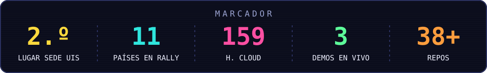
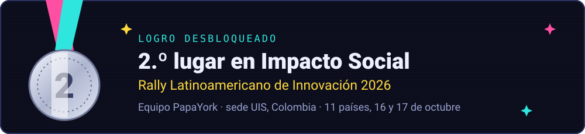
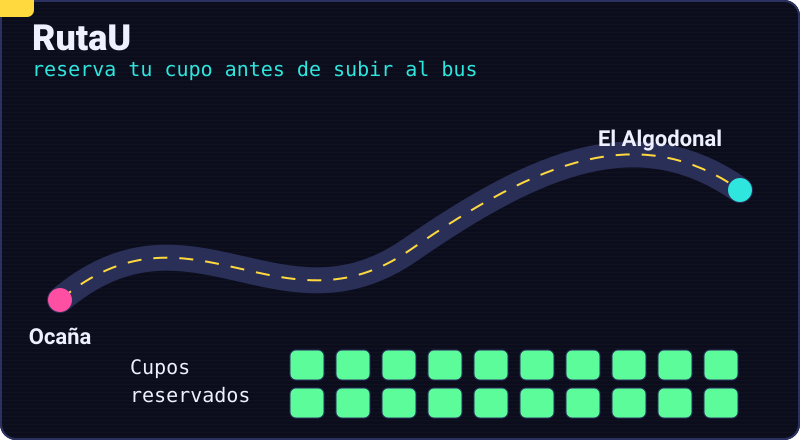

<picture>
<source media="(max-width: 600px)" srcset="assets/readme/hero-mobile.svg">

</picture>

Soy Fabi, pero acá soy <b>Glam</b>. Este es mi espacio para subir las cosas que hago.

<b>Recruiter? Read this in English</b>

 
Systems Engineering student at UFPSO (Colombia), looking for a first professional role. My thesis project, Capriva, is a goat-herd management platform (React, Symfony, Oracle, FastAPI, local AI) now being rolled out at the university's experimental farm. I also build Archito, a Rust and Tauri desktop companion for learning Arch Linux. My team PapaYork won second place in the Social Impact category at our site in the 2026 Latin American Innovation Rally. I am especially interested in cybersecurity and open to other areas: I am building AtomShield, a personal and fully simulated OT/ICS security lab whose first testbed already runs in an isolated VM. I also made PapaYork, a pixel-art farming game in GDevelop 5. Spanish: native. English: conversational.

">

<h2>Sobre mí</h2>

Estudio Ingeniería de Sistemas en la UFPSO desde 2022 y me gusta entender lo que hay detrás de cada proyecto. Cabras, papas mutantes, buses universitarios, puertas con reconocimiento facial y Arch Linux: cada problema me ha obligado a aprender una tecnología nueva y a buscarle el mayor provecho.

Mi trabajo de grado ya está en proceso de implementación en la universidad. Tengo especial interés en la ciberseguridad, aunque no me cierro a un área, y por eso construyo AtomShield, un laboratorio simulado de seguridad industrial. Busco una primera experiencia profesional donde pueda aportar lo que ya sé y aprender de un equipo.

 

<table>
<tr>
<td width="50%" valign="top"><b>Llevo proyectos de punta a punta</b> En Capriva participé en todo el ciclo: análisis del problema, arquitectura, desarrollo y despliegue.</td>
<td width="50%" valign="top"><b>Pienso en quien intenta saltarse el sistema</b> Portero frena fotos y pantallas con una prueba de presencia. Cada registro de su historial firma al anterior, así que una alteración se detecta.</td>
</tr>
<tr>
<td width="50%" valign="top"><b>Automatizo la nube</b> AWS-Iac-150 despliega cinco stacks de CloudFormation desde GitHub Actions. Lo que aprendí con EC2, S3 e IAM me sirvió para desplegar Capriva.</td>
<td width="50%" valign="top"><b>Uso IA sin soltar el control</b> En Capriva el motor calcula y la IA local solo redacta. Un validador marca cualquier cifra que no aparezca en el informe.</td>
</tr>
</table>

 

<h2>Proyectos</h2>

<table>
<tr>
<td colspan="2">

<h3>Capriva</h3>
PROYECTO CAPRINO · TRABAJO DE GRADO · EN IMPLEMENTACIÓN

La Granja Experimental de la UFPSO llevaba su hato en registros manuales. Capriva guarda la vida de cada animal: genealogía, reproducción, salud, leche y pesajes. También calcula consanguinidad y valores genéticos por BLUP para elegir mejores cruces, y evalúa bienestar animal con la metodología MEBA del ICA.

<code>React</code> <code>Symfony</code> <code>Oracle</code> <code>FastAPI</code> <code>Ollama</code> <code>Capacitor</code> <code>AWS</code>

<a href="https://github.com/fabiiianac15/Proyecto-Caprino">Ver repositorio</a>
</td>
</tr>
<tr>
<td colspan="2">

<h3>AtomShield</h3>
CIBERSEGURIDAD OT/ICS · EN CONSTRUCCIÓN · REPOSITORIO PRIVADO

Mi laboratorio personal para aprender a defender sistemas industriales. Quien lo usa trabaja como analista junior en una organización nuclear ficticia: recibe tickets, revisa evidencias, escala decisiones y entrega informes, con herramientas reales sobre una red aislada.

La base documental ya existe: arquitectura de referencia por zonas, 7 procedimientos con sus plantillas, 12 casos de uso de detección y 13 escenarios defensivos. El laboratorio también arrancó: GRFICSv3, que simula una planta química, corre reducido en una VM aislada con cinco contenedores. Al probarlo encontré que su red de administración permitía saltarse el router entre zonas, y la cerré.

El equipo donde corre se borra al reiniciar, así que preparé una imagen base que se restaura en unos 6 minutos y scripts que comprueban el aislamiento antes de cada sesión.

<code>OT/ICS</code> <code>Segmentación</code> <code>Detección</code> <code>Respuesta a incidentes</code> <code>Gestión de riesgos</code> <code>ISA/IEC 62443</code> <code>MITRE ATT&amp;CK</code> <code>NIST SP 800-82</code> <code>GRFICSv3</code> <code>Docker</code> <code>VirtualBox</code> <code>Debian</code>

Todo es simulado. No se conecta a ninguna instalación real y no equivale a una certificación, a formación nuclear ni a experiencia en una planta. Abriré el repositorio cuando el laboratorio tenga evidencias prácticas que mostrar.
</td>
</tr>
<tr>
<td width="54%" valign="top">
<h3>Archito</h3>
PROYECTO PERSONAL · v0.6.0

Mucha gente abandona Arch en el primer error que no entiende. Archito vive como una isla en el borde de la pantalla, explica cada comando antes de ejecutarlo, traduce los errores y comprueba en tu equipo real lo que aprendiste. Es la base de una idea mayor a futuro: Arch Mobile.

<code>Rust</code> <code>Tauri 2</code> <code>TypeScript</code> <code>Python</code> <code>IA local</code>

<a href="https://github.com/fabiiianac15/Archito/releases/download/appimage/Archito-x86_64.AppImage">Descargar AppImage</a> · <a href="https://github.com/fabiiianac15/Archito">Ver repositorio</a>
</td>
<td width="46%" align="center"><a href="https://github.com/fabiiianac15/Archito"> </a></td>
</tr>
<tr>
<td colspan="2">

<h3>PapaYork: Legado Radioactivo</h3>
VIDEOJUEGO · GDEVELOP 5 · EN DESARROLLO

Juego de granja en pixel art para la materia Desarrollo de Videojuegos. Pedro vuelve a la granja de su familia, cerca de una planta nuclear que explotó años atrás, y ahora algunas papas salen de la tierra con hambre. Se siembra y se cosecha por días, se habla con vecinos que tienen su propia rutina y se baja a una mina cuyos pisos se generan al azar.

Lo hice solo, y el arte y la música también salieron de código: generadores en Python y JavaScript dibujan personajes y terreno, y un script sintetiza la música sin muestras externas. Los cambios grandes al proyecto son 29 scripts de Python que editan su JSON.

<code>GDevelop 5</code> <code>JavaScript</code> <code>Python</code> <code>Pixel art</code> <code>Generación procedural</code>

<a href="https://github.com/fabiiianac15/PapaYork">Ver repositorio</a>
</td>
</tr>
<tr>
<td width="54%"></td>
<td width="46%" valign="top">
<h3>Portero</h3>
ACCESSCONTROL · SEGURIDAD

Nació por el ingreso de personas no autorizadas a un espacio de la universidad. Cada persona entra con rostro o PIN, y nadie está obligado a dar datos biométricos. El kiosco pide girar la cabeza en orden aleatorio para frenar fotos, y las plantillas faciales no salen de tu red.

<code>Python</code> <code>Visión artificial</code> <code>Docker</code>

<a href="https://github.com/fabiiianac15/AccessControl">Ver repositorio</a>
</td>
</tr>
<tr>
<td width="54%" valign="top">
<h3>Pawsible</h3>
MICROSERVICIOS · EN PRODUCCIÓN

Adopción de mascotas para la Fundación Huellas de Esperanza. Dos APIs independientes llevan el proceso completo y una mascota nunca queda con dos adopciones aprobadas: lo garantizan un <code>UPDATE</code> condicional, un bloqueo por mascota y un índice único parcial.

<code>React</code> <code>TypeScript</code> <code>FastAPI</code> <code>Supabase</code> <code>Vercel</code>

<a href="https://pawsible-two.vercel.app">Abrir demo</a> · <a href="https://github.com/fabiiianac15/Pawsible">Ver repositorio</a>
</td>
<td width="46%"></td>
</tr>
<tr>
<td width="54%"></td>
<td width="46%" valign="top">
<h3>RutaU</h3>
ARQUITECTURA ORIENTADA A SERVICIOS · EN PRODUCCIÓN

Reserva de cupos para el transporte de la UFPSO entre Ocaña y El Algodonal. El estudiante ve cuántos cupos quedan y reserva con su código. Se instala como PWA o como APK de Android, que GitHub Actions compila cuando cambia la web.

<code>React</code> <code>TypeScript</code> <code>PostgreSQL</code> <code>Capacitor</code> <code>Vercel</code>

<a href="https://rutau-web.vercel.app">Abrir demo</a> · <a href="https://github.com/fabiiianac15/RutaU">Ver repositorio</a>
</td>
</tr>
<tr>
<td width="54%" valign="top">
<h3>SubastApp</h3>
PLATAFORMA WEB COMPLETA

Quien vende publica un lote con fotos, precio de salida y fecha de cierre. Quien compra oferta hasta el último segundo y, si gana, paga desde su panel. El pago es una simulación, sin dinero real.

<code>React</code> <code>Express</code> <code>MongoDB</code>

<a href="https://github.com/fabiiianac15/SubastaApp">Ver repositorio</a>
</td>
<td width="46%"></td>
</tr>
<tr>
<td width="54%"></td>
<td width="46%" valign="top">
<h3>AWS-Iac-150</h3>
INFRAESTRUCTURA COMO CÓDIGO

Levanta por etapas una arquitectura en <code>us-east-1</code>: VPC con dos subredes, reglas de seguridad, instancias EC2, balanceador y Auto Scaling con Warm Pool. Otro workflow elimina los stacks.

<code>AWS</code> <code>CloudFormation</code> <code>GitHub Actions</code>

<a href="https://github.com/fabiiianac15/AWS-Iac-150">Ver repositorio</a>
</td>
</tr>
</table>

<b>Otros proyectos</b>

 
<a href="https://github.com/fabiiianac15/API-Sentir"><b>API SENTIR</b></a>: API REST con FastAPI y PostgreSQL para registrar personas, reportar emergencias y asociarles una ubicación.  
<a href="https://fabiiianac15.github.io/EduFinanzas/"><b>EduFinanzas</b></a>: una de mis primeras webs. Finanzas personales con cálculos, gráficas y un chatbot de respuestas preprogramadas.

<h2>Con qué trabajo</h2>

<table>
<tr><td><b>Lenguajes</b></td><td></td></tr>
<tr><td><b>Frontend</b></td><td></td></tr>
<tr><td><b>Backend</b></td><td></td></tr>
<tr><td><b>Datos</b></td><td> </td></tr>
<tr><td><b>Cloud e infra</b></td><td></td></tr>
<tr><td><b>IA y datos</b></td><td><picture><source media="(prefers-color-scheme: dark)" srcset="https://cdn.simpleicons.org/ollama/ffffff"></picture> &nbsp; </td></tr>
<tr><td><b>Herramientas</b></td><td> </td></tr>
</table>

<h2>Trayectoria</h2>

<table>
<tr><td><b>Hoy</b></td><td>Capriva en implementación en la universidad, Archito en desarrollo activo y AtomShield con su primera plataforma corriendo en una VM aislada.</td></tr>
<tr><td><b>Oct 2026</b></td><td>Segundo lugar en Impacto Social con el equipo PapaYork, en el Rally Latinoamericano de Innovación (sede UIS).</td></tr>
<tr><td><b>Mar 2026</b></td><td>Bootcamp Arquitectura en la Nube, nivel básico, 159 horas. Talento Tech, con MinTIC y ANDES.</td></tr>
<tr><td><b>2023</b></td><td>Mis primeros repositorios en GitHub.</td></tr>
<tr><td><b>2022</b></td><td>Empiezo Ingeniería de Sistemas en la Universidad Francisco de Paula Santander Ocaña.</td></tr>
</table>

<b>Idiomas:</b> español nativo, inglés conversacional.

<h2>Lo que suena mientras programo</h2>

<h2>Mis contribuciones, a punto de ser devoradas</h2>
<picture>
<source media="(prefers-color-scheme: dark)" srcset="https://raw.githubusercontent.com/fabiiianac15/fabiiianac15/output/pacman-contribution-graph-dark.svg">
<source media="(prefers-color-scheme: light)" srcset="https://raw.githubusercontent.com/fabiiianac15/fabiiianac15/output/pacman-contribution-graph.svg">

</picture>
<h2>¿Hablamos?</h2>

Si tienes una vacante, una práctica o un problema interesante, escríbeme.

